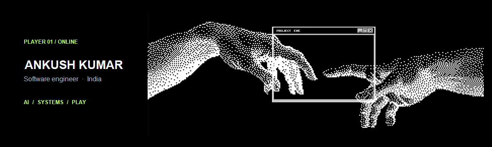
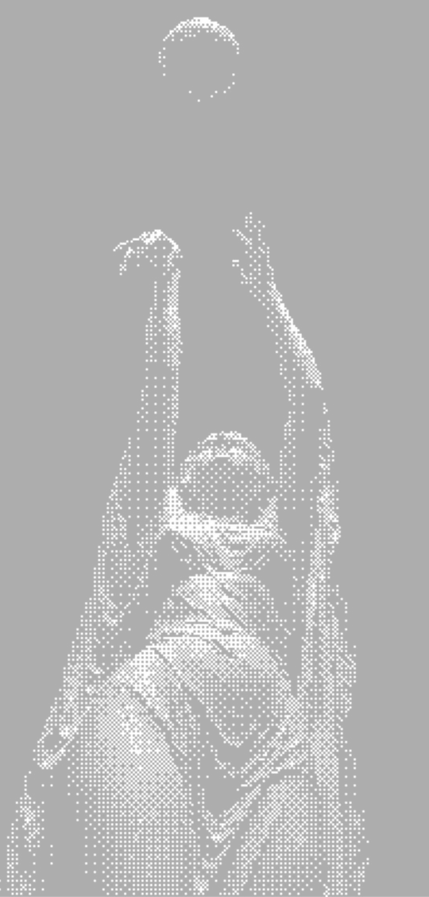

  

  

  
  
  

## `01 / PLAYER PROFILE`

I’m **Ankush**, a software engineer in India. I move between AI and data systems, useful desktop tools, and interactive experiments. I like projects where the engineering is real and the interface has a little personality.

> **Current build philosophy:** make it useful, make it feel good, learn something strange along the way.

## `02 / SELECTED BUILDS`

### 01 — [GigShield](https://github.com/AnkushKr836/GigShield)

INCOME PROTECTION / PARAMETRIC INSURANCE 
Weather, traffic, and civic disruption become signals for income-loss protection built around India’s delivery workforce.

### 02 — [AI Military Intelligence Dashboard](https://github.com/AnkushKr836/AI_Military_Intelligence_Dashboard)

DATA EXPLORATION / GEO-SPATIAL ANALYSIS 
An interactive look at patterns in the Global Terrorism Database, with mapping, prediction, and forecasting tools.

### 03 — [Personal Device Analytics](https://github.com/AnkushKr836/Personal-Device-Analytics-Platform)

DESKTOP / CLASSICAL MACHINE LEARNING 
A system monitor that predicts resource use, checks device health, and turns the signals into optimization ideas.

### 04 — [The side quests](https://github.com/AnkushKr836?tab=repositories)

UNITY / CREATIVE CODE / HARDWARE 
Neon arcade experiments, prototypes, and the occasional sensor that finally talks back.

 
## `03 / TOOLKIT`

<table>
  <tr>
    <td width="50%" valign="top">
      <strong>LANGUAGES</strong>  
      
    </td>
    <td width="50%" valign="top">
      <strong>WEB</strong>  
      
    </td>
  </tr>
  <tr>
    <td width="50%" valign="top">
      <strong>BACKEND &amp; DATA</strong>  
      
    </td>
    <td width="50%" valign="top">
      <strong>CREATIVE &amp; HARDWARE</strong>  
       
      ESP32
    </td>
  </tr>
</table>

## `04 / PLAYER STATS`

  
  

  

## `05 / CONTRIBUTION ARCADE`

  <picture>
    <source media="(prefers-color-scheme: dark)" srcset="https://raw.githubusercontent.com/AnkushKr836/AnkushKr836/output/github-snake-dark.svg" />
    <source media="(prefers-color-scheme: light)" srcset="https://raw.githubusercontent.com/AnkushKr836/AnkushKr836/output/github-snake.svg" />
    
  </picture>

THE SNAKE REFRESHES DAILY · INSERT COFFEE. BUILD THINGS.

---

<a href="https://github.com/AnkushKr836">ANKUSHKR836</a> · BUILT WITH CURIOSITY · CHECKPOINT SAVED

